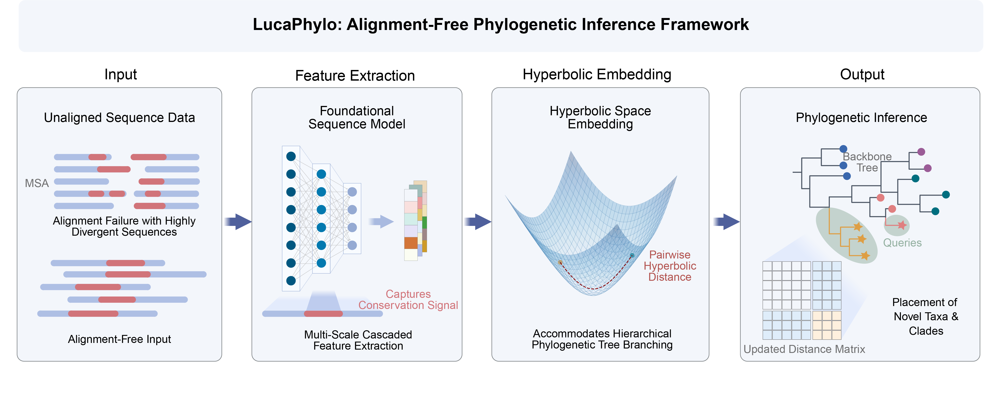
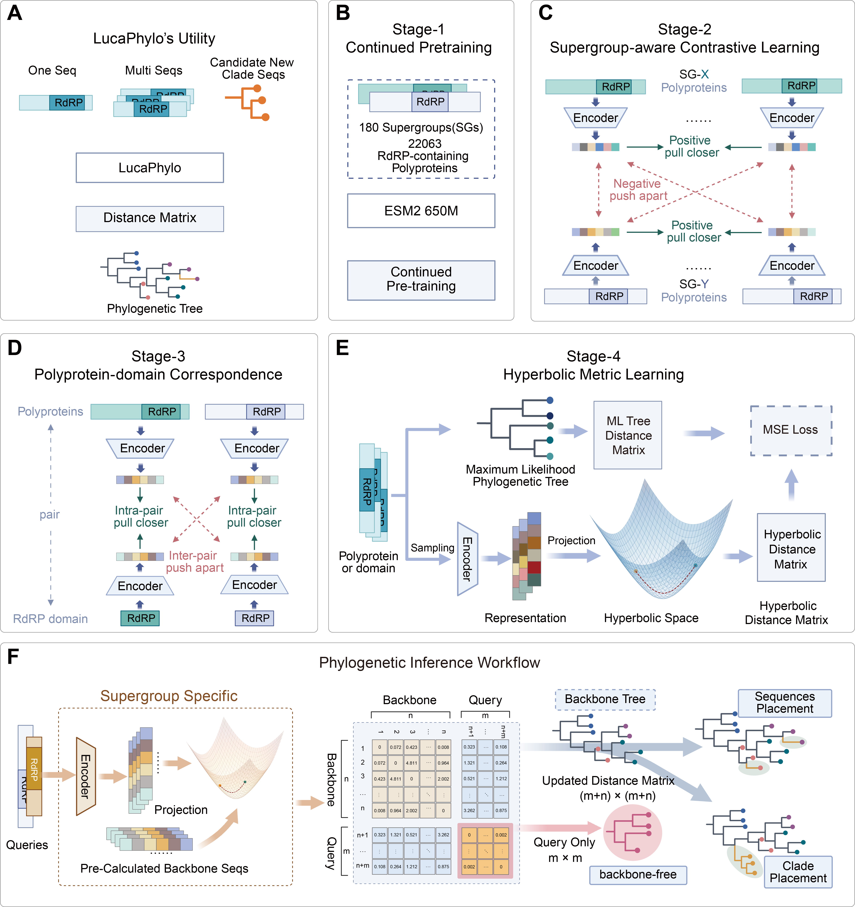
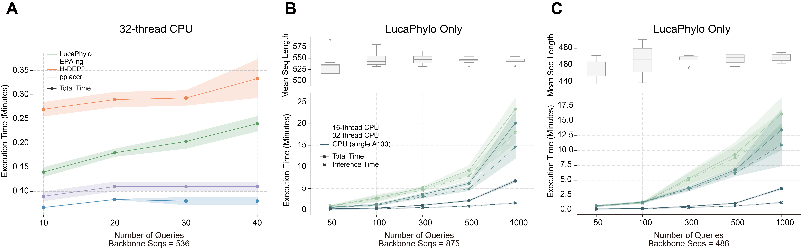

# LucaPhylo

[](https://www.biorxiv.org/content/early/2026/05/29/2026.05.26.723419)
[](LICENSE)

**Alignment-free phylogenetic inference via hyperbolic protein language models.**

LucaPhylo is a deep learning framework that places unaligned protein sequences into phylogenetic trees without requiring multiple sequence alignment (MSA). It integrates protein language models (ESM2) with hyperbolic geometry to capture hierarchical evolutionary signals, enabling phylogenetic inference for highly divergent sequences that conventional MSA-based pipelines often discard.



## Overview

LucaPhylo employs a four-stage cascaded training pipeline:

- Stage-1: continued pretraining from ESM2 650M
- Stage-2: label-aware contrastive learning
- Stage-3: paired polyprotein-domain contrastive learning
- Stage-4: hyperbolic adaptation



## Timeline

| Date | Event |
|------|-------|
| 2026-05-30 | Preprint released on [bioRxiv](https://www.biorxiv.org/content/early/2026/05/29/2026.05.26.723419) |
| 2026-05-30 | v1.0 — Initial release: full training pipeline, checkpoints, and inference scripts |

## Hardware Requirements

### Training

All training stages were conducted on **NVIDIA A100 GPUs**.

### Inference Benchmarks



End-to-end Stage-4 phylogenetic placement execution time of LucaPhylo compared with baseline alignment-based placement tools (EPA-ng, H-DEPP, pplacer) on 32-thread CPU (A). Internal performance profiling across 16-thread CPU, 32-thread CPU, and a single A100 GPU on backbone trees of 875 (B) and 486 (C) sequences with varying query cohort sizes.


## Training Data

The training data for Stages 1–3 was curated from our previous work, the [LucaProt](https://www.cell.com/cell/fulltext/S0092-8674(24)01085-7) study, encompassing **22,063 representative polyprotein sequences and their corresponding RdRP domains** across **180 viral supergroups** (including 21 ICTV-recognized supergroups).


## Environment Installation

LucaPhylo is a training and inference framework. Set up the environment as follows:

1. Create a virtual environment.

```bash
conda create -n lucaphylo python=3.10.16
```

2. Activate the environment.

```bash
conda activate lucaphylo
```

3. Clone the repository.

```bash
git clone https://github.com/NickShannn/LucaPhylo.git
cd LucaPhylo
```

4. Install dependencies.

```bash
pip install -r requirements.txt -i https://pypi.tuna.tsinghua.edu.cn/simple
```

## Checkpoints

Checkpoint weights from Stage-1 to Stage-3 are available on [Hugging Face](https://huggingface.co/NickShan/LucaPhylo) and [Zenodo](https://zenodo.org/records/19401368).

## Data Availability

Training data, additional data, and external evaluation sets are available on [Zenodo](https://zenodo.org/records/19401368).

## Training Stages

All Stage-scripts support multi-GPU training via `NUM_GPUS` and `CUDA_VISIBLE_DEVICES`. Extra command-line arguments are forwarded to the Python entry point:

```bash
CUDA_VISIBLE_DEVICES=0,1,2,3 NUM_GPUS=4 bash scripts/run_stage_2.sh
NUM_GPUS=2 bash scripts/run_stage_3.sh --num_train_epochs 10 --learning_rate 1e-5
```

### Stage-1

Continued pretraining from ESM2 650M using masked language modeling (MLM).

```bash
bash scripts/run_stage_1.sh
```

- **Input:** `.tsv` file, one protein sequence per line

### Stage-2

Label-aware contrastive learning.

```bash
bash scripts/run_stage_2.sh
```

- **Input:** CSV with columns `seq,label`

Example:

```text
seq,label
SEQUENCE_A,Label_1
SEQUENCE_B,Label_1
SEQUENCE_C,Label_2
```

### Stage-3

Paired contrastive learning between an anchor sequence and a paired positive sequence.

```bash
bash scripts/run_stage_3.sh
```

- **Input:** CSV with columns `polyprotein_seq,domain_seq`

Example:

```text
polyprotein_seq,domain_seq
POLYPROTEIN_SEQ_1,DOMAIN_SEQ_1
POLYPROTEIN_SEQ_2,DOMAIN_SEQ_2
```

### Stage-4 Training

Distance regression on phylogenetic sequence pairs using a Stage-2 or Stage-3 checkpoint as the encoder backbone.

```bash
bash scripts/run_stage_4_train.sh
```

Required arguments:

| Argument | Description |
|----------|-------------|
| `--model_name_or_path` | Stage-2 or Stage-3 checkpoint |
| `--tree_path` | Backbone tree in Newick format |
| `--fasta_path` | Backbone sequences in FASTA format (IDs must match tree leaves) |
| `--output_dir` | Output directory |

Optional:

| Argument | Description |
|----------|-------------|
| `--split_file` | CSV with two columns, `train` and `valid`, each containing the corresponding set of sequence IDs |

### Stage-4 Inference

Use the trained Stage-4 hyperbolic adapter together with its corresponding base Stage-2/3 checkpoint for phylogenetic inference.

```bash
bash scripts/run_stage_4_infer.sh
```

Key arguments:

| Argument | Description |
|----------|-------------|
| `--model_name_or_path` | Stage-2 or Stage-3 base checkpoint |
| `--stage4_adapter_path` | Stage-4 LoRA adapter directory |
| `--backbone_tree` | Backbone tree in Newick format |
| `--backbone_seqs` | Backbone sequences in FASTA format |
| `--query_seqs` | Query sequences to place onto the backbone |
| `--output_dir` | Output directory for distance matrices |
| `--save_nj_tree` | (optional) Also write Neighbor-Joining trees |
| `--device` | Device for inference (default: `cuda:0`) |

Output files:

- `stage4_full_distance_matrix.csv` — full distance matrix (backbone + queries)
- `stage4_query_distance_matrix.csv` — query-to-query distances only
- `stage4_full_distance_matrix.nwk` — Neighbor-Joining tree (if `--save_nj_tree`)
- `stage4_infer_summary.json` — run metadata

## Applications

### [LucaPhylo in RNA Virus](https://github.com/NickShannn/LucaPhylo_RNA_Virus)

RNA-virus-specific phylogenetic placement workflows built on LucaPhylo.


## Citation

If you use LucaPhylo in your research, please cite:

```bibtex
@article {LucaPhylo,
	author = {Shan, Yongtao and Fang, Pan and Liu, Yuqi and Pan, Yuanfei and Liu, Kaijie and He, Yong and Liu, Xue and Wu, Weichen and Xue, Guirong and He, Jian and Guo, Deyin and He, Jianguo and Holmes, Edward C. and Shi, Mang and Li, Zhaorong},
	title = {Alignment-free phylogenetic inference via hyperbolic protein language models},
	elocation-id = {2026.05.26.723419},
	year = {2026},
	doi = {10.64898/2026.05.26.723419},
	publisher = {Cold Spring Harbor Laboratory},
	URL = {https://www.biorxiv.org/content/early/2026/05/29/2026.05.26.723419},
	eprint = {https://www.biorxiv.org/content/early/2026/05/29/2026.05.26.723419.full.pdf},
	journal = {bioRxiv}
}

```


